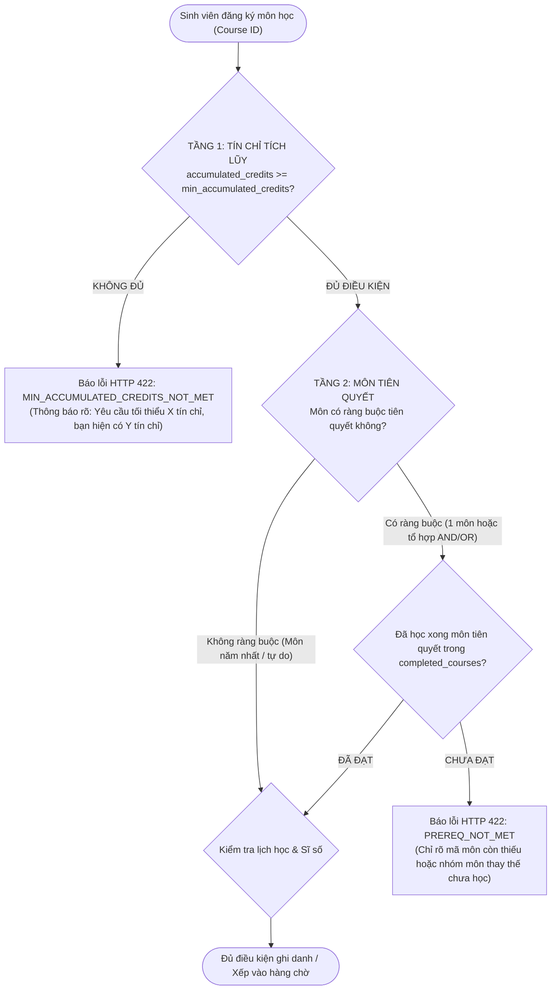

# KẾ HOẠCH CHI TIẾT: BỔ SUNG RÀNG BUỘC TÍN CHỈ TÍCH LŨY, CHUẨN HÓA TIÊN QUYẾT & TRỰC QUAN HÓA ĐỒ THỊ DAG

> **Tài liệu:** Đề xuất kỹ thuật & kế hoạch hiện thực hóa hệ thống kiểm tra điều kiện đăng ký 2 tầng, giao diện Tiến độ học tập & Trực quan hóa đồ thị tiên quyết.  
> **Trạng thái:** Bản thảo đề xuất cập nhật theo yêu cầu người dùng (Chờ duyệt trước khi triển khai).  
> **Ngày lập:** 09/11/2026.

---

## 1. GIẢI ĐÁP & XÁC NHẬN CÁC THẮC MẮC CỦA BẠN

### 1.1. Về việc "Hiện tại hệ thống chưa kiểm tra số tín chỉ tích lũy"
* **Xác nhận 100% đúng**: Trong hệ thống hiện tại, bảng `students` chỉ mới có cột `max_credits` (số tín chỉ tối đa được đăng ký *trong 1 học kỳ*, ví dụ 25 tín chỉ). Hoàn toàn **chưa có cột `accumulated_credits`** (tổng số tín chỉ sinh viên đã tích lũy từ trước đến nay) và bảng `courses` cũng **chưa có cột `min_accumulated_credits`** (tín chỉ tích lũy tối thiểu để đủ điều kiện học).
* Engine `/enroll` hiện tại mới chỉ kiểm tra: môn đã đạt chưa -> trùng môn kỳ này -> trùng lịch -> vượt `max_credits` kỳ này -> môn tiên quyết trong `prerequisites`.

### 1.2. Về việc "Đồ thị tiên quyết tôi chưa thấy ở đâu hết"
* **Lý do bạn chưa thấy**: Đồ thị tiên quyết (DAG) với 338 mối quan hệ AND/OR hiện tại **mới chỉ nằm ở tầng Backend và CSDL** (trong bảng `prerequisites`, thuật toán BFS/DFS, kiểm tra chu trình và cache Redis).
* Frontend hiện tại chỉ có: Trang Chủ (Dashboard), Danh sách môn học (`/courses`), Thời khóa biểu (`/timetable`), và Quản trị (`/admin`). **Frontend hoàn toàn CHƯA CÓ trang hoặc màn hình trực quan hóa sơ đồ cây tiên quyết** để sinh viên nhìn thấy trực quan các node và đường nối!
* **Giải pháp bổ sung:** Chúng ta sẽ xây dựng giao diện **Trực quan hóa Đồ thị Tiên quyết (DAG Visualizer)** tương tác trên Frontend để sinh viên và quản trị viên nhìn thấy rõ ràng từng nhánh môn học.

### 1.3. Về mục riêng xem "Môn học đã học & Số tín chỉ tích lũy"
* Chúng ta sẽ tạo một mục riêng trên Menu: **"Hồ sơ học tập" (`/academic-record`)**, hiển thị tổng tín chỉ tích lũy, điểm GPA, và bảng chi tiết toàn bộ các môn sinh viên đã học xong kèm điểm số thang 10, điểm chữ và học kỳ đạt.

---

## 2. KIẾN TRÚC MÔ HÌNH KIỂM TRA ĐIỀU KIỆN 2 TẦNG (TWO-TIER ELIGIBILITY)



---

## 3. THIẾT KẾ CƠ SỞ DỮ LIỆU & MIGRATION

### 3.1. Cập nhật Model & Bảng `students`
* Thêm cột: `accumulated_credits: Mapped[int] = mapped_column(SmallInteger, nullable=False, server_default=text("0"))`
* Ràng buộc: `CheckConstraint("accumulated_credits >= 0 AND accumulated_credits <= 200", name="ck_students_accumulated_credits")`

### 3.2. Cập nhật Model & Bảng `courses`
* Thêm cột: `min_accumulated_credits: Mapped[int] = mapped_column(SmallInteger, nullable=False, server_default=text("0"))`
* Ràng buộc: `CheckConstraint("min_accumulated_credits >= 0 AND min_accumulated_credits <= 150", name="ck_courses_min_accumulated_credits")`

### 3.3. File Alembic Migration
Tạo file migration `0002_add_accumulated_credits.py` với `upgrade()` và `downgrade()` an toàn.

---

## 4. MA TRẬN ĐÁNH GIÁ ĐỘ KHÓ 200 MÔN HỌC (7 LEVEL)

Dưới đây là ma trận phân bổ độ khó theo cấp độ đào tạo đại học chuẩn:

| Cấp độ | Giai đoạn đề xuất | Tín chỉ tích lũy tối thiểu (`min_accumulated_credits`) | Đặc điểm ràng buộc môn tiên quyết | Ví dụ môn tiêu biểu |
| :---: | :---: | :---: | :--- | :--- |
| **Level 1** | **Năm nhất (HK1)** | **0 tín chỉ** *(Không yêu cầu)* | **Không có môn tiên quyết** (0 môn). Sinh viên năm nhất vào học được ngay. | `INT101` (Nhập môn lập trình), `MAT201` (Giải tích), `MAT202` (Đại số tuyến tính), `BAS101` - `BAS108` (Kỹ năng mềm 1-8). |
| **Level 2** | **Năm nhất (HK2)** | **12 - 15 tín chỉ** | Yêu cầu **1 môn tiên quyết** từ Level 1. | `INT131` (OOP - cần `INT101`). |
| **Level 3** | **Năm hai (HK3 - HK4)** | **30 - 35 tín chỉ** | Yêu cầu các môn cơ sở nhóm ngành từ Level 2. | `INT221` (Cấu trúc dữ liệu - cần `INT131`), `INT222` (Cơ sở dữ liệu - cần `INT131`), `INT231` (Giải thuật - cần `INT131`). |
| **Level 4** | **Năm ba (HK5)** | **50 - 60 tín chỉ** | Tổ hợp AND (nhiều môn) hoặc OR (tự chọn hướng đi). | `INT321` (Hệ quản trị CSDL - cần cả `INT221` AND `INT222`), `INT341` (Học máy - cần `INT231` AND một trong hai môn Toán). |
| **Level 5** | **Năm ba (HK6)** | **70 - 75 tín chỉ** | Các môn phân tích, thiết kế chuyên sâu. | `INT331` (PT&TK Hệ thống - cần `INT231`), `INT451` (Chuyên đề ứng dụng). |
| **Level 6** | **Năm tư (HK7)** | **85 - 90 tín chỉ** | Chuỗi tiên quyết bắc cầu dài từ Level 4, 5. | `INT431` (Đồ án chuyên ngành - cần `INT331`), Các môn Công nghệ mới. |
| **Level 7** | **Năm tư (HK8)** | **100 - 105 tín chỉ** | Cấp cao nhất: Cần đủ tích lũy + hoàn thành Đồ án chuyên ngành. | `INT701` (Khóa luận tốt nghiệp / Đồ án tốt nghiệp). |

> [!NOTE]
> Có một số môn kỹ năng / tự do ở Level 2-3 chỉ yêu cầu số tín chỉ tích lũy (ví dụ >= 30 TC) mà **không đòi hỏi môn tiên quyết cụ thể** để sinh viên học linh hoạt.

---

## 5. THUẬT TOÁN "RANDOM CÓ KIỂM SOÁT" CHO DỮ LIỆU SINH VIÊN

Khi generate 1.001 sinh viên mẫu, quá trình ngẫu nhiên được kiểm soát chặt chẽ để đảm bảo tính logic và toàn vẹn tuyệt đối:

### 5.1. Nguyên tắc ngẫu nhiên có kiểm soát
1. **Duyệt DAG theo thứ tự Topo (Topological Order):** Sinh viên không bao giờ được random một môn học ở tầng trên nếu chưa học đủ các môn tiên quyết ở tầng dưới.
2. **Quy tắc bất biến (Invariant):**
   $$\text{student.accumulated\_credits} = \sum_{\text{course} \in \text{completed\_courses}} \text{course.credits}$$
   Số tín chỉ tích lũy trong hồ sơ sinh viên luôn khớp 100% với tổng số tín chỉ các môn đã đạt.
3. **Phân bổ theo khóa học:**
   * **Năm 1 (K24 - 25%):** Tích lũy 0 - 24 TC (0 - 8 môn).
   * **Năm 2 (K23 - 25%):** Tích lũy 25 - 55 TC (9 - 18 môn).
   * **Năm 3 (K22 - 25%):** Tích lũy 56 - 85 TC (19 - 28 môn).
   * **Năm 4 (K21 - 25%):** Tích lũy 86 - 125 TC (29 - 40 môn).

### 5.2. 5 Tài khoản Persona cố định phục vụ kiểm thử Demo trực tiếp

| Tài khoản | Mật khẩu | Đối tượng | Tín chỉ tích lũy | Kịch bản Demo kiểm thử trực quan |
| :--- | :---: | :--- | :---: | :--- |
| `sv0001@uni.edu.vn` | `Student@123` | **Tân sinh viên Năm 1 (K24)** | **0 TC** | Vào mục "Hồ sơ học tập" thấy trống (0 TC). Đăng ký môn năm 1 (`INT101`, `MAT201`) -> **Thành công**. Đăng ký môn năm 2/3 -> **Bị chặn ngay vì thiếu TC tích lũy**. |
| `sv0002@uni.edu.vn` | `Student@123` | **Sinh viên Năm 1 HK2 (K24)** | **18 TC** | Đã học xong `INT101`, `MAT201`, `MAT202` và môn kỹ năng. Đủ điều kiện đăng ký `INT131` (OOP). Thử đăng ký môn năm 2/3 -> Bị chặn. |
| `sv0003@uni.edu.vn` | `Student@123` | **Sinh viên Năm 2 (K23)** | **42 TC** | Đã hoàn thành `INT131`, đủ điều kiện đăng ký `INT221` (CTDL), `INT222` (CSDL), `INT231` (Giải thuật). Xem sơ đồ thấy cây sáng xanh nửa đầu. |
| `sv0004@uni.edu.vn` | `Student@123` | **Sinh viên Năm 3 (K22)** | **75 TC** | Đã xong các môn cơ sở ngành, đủ điều kiện đăng ký Chuyên đề, Học máy `INT341`, PT&TKHT `INT331`. |
| `sv0005@uni.edu.vn` | `Student@123` | **Sinh viên Năm 4 (K21)** | **111 TC** | Đã hoàn thành gần hết chương trình, đủ điều kiện đăng ký Đồ án chuyên ngành `INT431` và Khóa luận tốt nghiệp `INT701`. |

---

## 6. GIAO DIỆN MỚI 1: MỤC "HỒ SƠ HỌC TẬP" (`/academic-record`)

Thêm một mục riêng biệt trên thanh điều hướng Menu (Icon: `GraduationCap` / `Award`):
1. **Khối Thống kê Tổng quan (Summary Cards):**
   * **Tín chỉ tích lũy:** Ví dụ: `45 / 130 tín chỉ` kèm Progress Bar trực quan.
   * **Điểm trung bình tích lũy (GPA):** Ví dụ: `7.85 / 10.0` (Xếp loại Khá/Giỏi).
   * **Số môn đã hoàn thành:** Ví dụ: `15 môn học đã đạt`.
2. **Khối Bảng chi tiết môn đã học (Completed Courses Table):**
   * Các cột: STT, Mã môn, Tên môn học, Số tín chỉ, Điểm số (thang 10), Điểm chữ (A, B+, B, C...), Học kỳ đạt (ví dụ: `2024-1`, `2024-2`), Trạng thái (🟢 Đã đạt).
   * Hỗ trợ tìm kiếm theo tên môn và lọc theo học kỳ.

---

## 7. GIAO DIỆN MỚI 2: TRỰC QUAN HÓA ĐỒ THỊ TIÊN QUYẾT (DAG VISUALIZER)

Để người dùng có thể nhìn thấy đồ thị tiên quyết một cách trực quan, sinh động:

### 7.1. Trang riêng: "Sơ đồ tiên quyết" (`/prerequisites`)
* **Giao diện phân tầng trực quan:**
  * Chia thành 7 Cột tương ứng với 7 Cấp độ (Level 1: Năm 1 -> Level 7: Khóa luận).
  * Mỗi môn học là một **Card / Node** hiển thị: Mã môn, Tên môn, Số TC, Tín chỉ tích lũy tối thiểu.
  * Các đường mũi tên hoặc thẻ liên kết chỉ rõ quan hệ tiên quyết:
    * Mũi tên liền: Mối quan hệ bắt buộc **AND**.
    * Khung nhóm bo tròn: Mối quan hệ tự chọn **OR** (chọn 1 trong các môn).
* **Trạng thái màu sắc theo thời gian thực của sinh viên đang đăng nhập:**
  * 🟢 **Màu xanh lá:** Môn sinh viên **ĐÃ HỌC XONG** (có trong `completed_courses`).
  * 🟡 **Màu vàng rực rỡ:** Môn sinh viên **ĐỦ ĐIỀU KIỆN ĐĂNG KÝ NGAY** (đã đạt tất cả môn tiên quyết + đủ tín chỉ tích lũy).
  * 🔴 **Màu xám / Icon Ổ khóa:** Môn **CHƯA ĐỦ ĐIỀU KIỆN** (chưa học môn tiên quyết hoặc chưa đủ tín chỉ tích lũy).
* **Tương tác khi bấm vào một Node:**
  * Mở Drawer/Modal chi tiết hiển thị:
    * Cây phả hệ của môn đó: Các môn cần học trước (Parents).
    * Các môn tương lai sẽ mở khóa sau khi học xong môn này (Children).
    * Nút tắt đăng ký nhanh nếu môn đang có lớp mở trong kỳ.

### 7.2. Tích hợp trong trang Môn học (`/courses`)
* Ở mỗi thẻ môn học, bổ sung nút **"Xem cây tiên quyết"**.
* Bấm vào sẽ mở popup hiển thị sơ đồ nhánh nhỏ của riêng môn học đó, giải thích rõ ràng tại sao sinh viên đủ hoặc chưa đủ điều kiện.

---

## 8. CẬP NHẬT BACKEND API

1. **Thêm API Lịch sử học tập & Tín chỉ tích lũy:**
   * `GET /api/v1/students/me/academic-record`:
     * Trả về thông tin sinh viên, tổng số `accumulated_credits`, điểm GPA và danh sách chi tiết các môn trong `completed_courses`.
2. **Cập nhật API Đồ thị tiên quyết cho Frontend:**
   * `GET /api/v1/prerequisites/graph`:
     * Trả về toàn bộ danh mục 200 môn học theo tầng (Level 1 - 7), danh sách các cạnh AND / OR, kèm cờ trạng thái của sinh viên hiện tại (`completed`, `eligible`, `locked`).
3. **Cập nhật Engine Đăng ký `/enroll` & Kiểm tra `/courses/{id}/eligibility`:**
   * Bổ sung kiểm tra tầng tín chỉ tích lũy trước:
     * Nếu `student.accumulated_credits < course.min_accumulated_credits` -> HTTP 422 `MIN_ACCUMULATED_CREDITS_NOT_MET`.
     * Sau đó kiểm tra môn tiên quyết -> HTTP 422 `PREREQ_NOT_MET`.

---

## 9. KẾ HOẠCH BÀI TEST & ĐẢM BẢO CHẤT LƯỢNG

1. **Unit Tests Backend:**
   * Test kiểm tra tầng tín chỉ tích lũy: đủ/thiếu tín chỉ.
   * Test kiểm tra tầng môn tiên quyết: đủ/thiếu môn AND, nhóm OR.
   * Test API `/students/me/academic-record`.
   * Test API `/prerequisites/graph`.
2. **Invariants Kiểm tra Bất biến toàn vẹn CSDL:**
   * Bổ sung kiểm tra: Tổng số tín chỉ của các môn trong `completed_courses` phải bằng đúng `accumulated_credits` của từng sinh viên.
   * Bổ sung kiểm tra: Mọi môn Level 1 đều có `min_accumulated_credits == 0` và 0 môn tiên quyết.
3. **Frontend Vitest & Lint:**
   * Viết test kiểm tra hiển thị trang Hồ sơ học tập và component Đồ thị tiên quyết.
   * Đảm bảo Typecheck, Lint, Prettier và Vitest 100% xanh.

---

## 10. LỘ TRÌNH THỰC HIỆN TỪNG BƯỚC

```
[Bước 1] Database Migration: Thêm cột accumulated_credits và min_accumulated_credits
     ↓
[Bước 2] Seed Generator: Cập nhật ma trận phân bổ tín chỉ 200 môn & thuật toán random có kiểm soát 1.001 sinh viên
     ↓
[Bước 3] Backend API:
         - Viết API GET /students/me/academic-record
         - Viết API GET /prerequisites/graph
         - Cập nhật luồng kiểm tra 2 tầng trong /enroll
     ↓
[Bước 4] Frontend UI:
         - Xây dựng trang "Hồ sơ học tập" (/academic-record)
         - Xây dựng trang "Sơ đồ tiên quyết" trực quan (/prerequisites)
         - Gắn badge điều kiện vào thẻ môn học (/courses)
     ↓
[Bước 5] Quality Gates:
         - Viết Unit Tests mới cho backend & frontend
         - Chạy toàn bộ test suites, linter, formatter, invariants check
```

---

> [!TIP]
> Kế hoạch này đáp ứng trọn vẹn cả 3 yêu cầu của bạn:
> 1. Có mục riêng để xem môn đã học và tín chỉ tích lũy.
> 2. Sinh viên được sinh dữ liệu ngẫu nhiên có kiểm soát chặt chẽ theo phân phối học tập logic.
> 3. Trực quan hóa toàn bộ Đồ thị tiên quyết một cách trực quan, sinh động ngay trên giao diện web.
